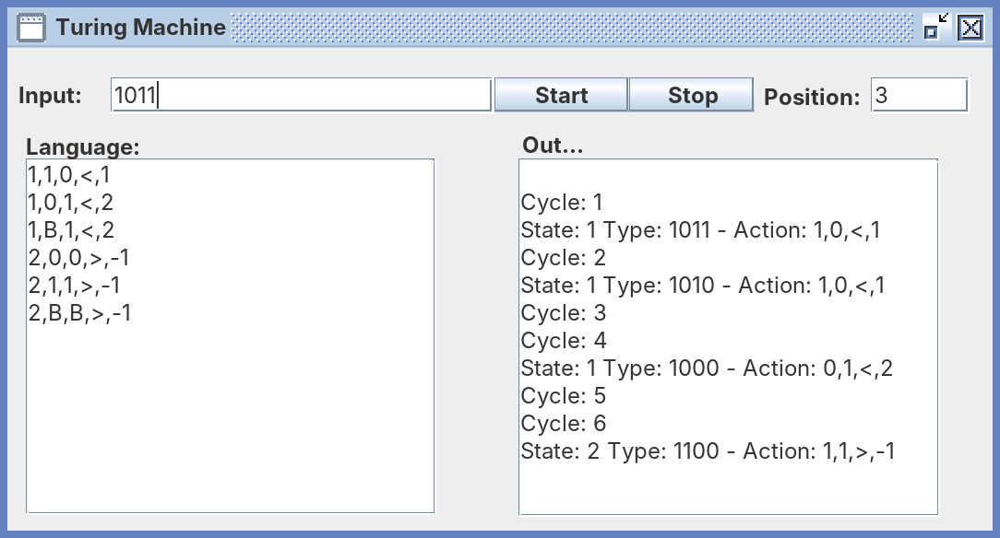
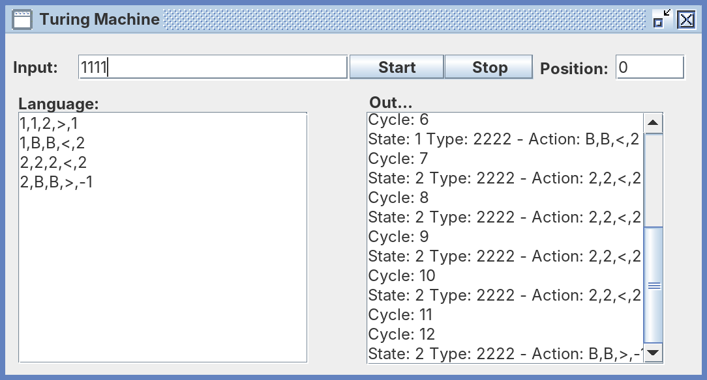

# Turing machine
Turing machine written for a university assignment in 2007.

## Screenshots



**Binary increment:** the head starts on the last digit of `1011` (position 3), moves left turning `1`s into `0`s until it can turn a `0` (or blank) into `1`, then halts, leaving `1100`.



**Fill and rewind:** the program from `TestCase.java` replaces every `1` with `2`, then walks back to the start of the tape and halts.

## Writing a program

Each line in **Language** is one rule:

```
state,read,write,move,next
```

- `state`: the state the rule belongs to, starting at `1`
- `read`: the symbol that must be under the head for the rule to fire
- `write`: the symbol to write in its place
- `move`: `<` (left) or `>` (right)
- `next`: the state to go to, or `-1` to halt (a halting rule's write and move are skipped)

`B` is the blank symbol, and the tape grows in either direction as needed. **Position** is the head's starting index on the input (0-based, defaults to 0).

## Running

```
javac -d bin src/turing_machine/*.java
java -cp bin turing_machine.App
```
